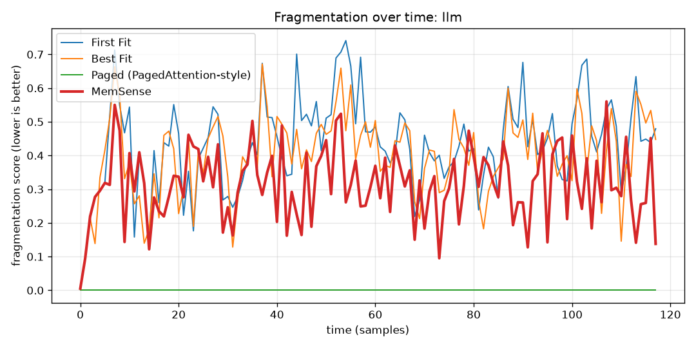

# MemSense: an Adaptive Memory Allocator and Fragmentation Doctor

> *An allocator that doesn't just manage memory, it learns, diagnoses, and heals it.*


## The problem
Long-running systems (servers, databases, game engines, GPU memory for LLMs) slowly die from **memory fragmentation**: free memory exists, but only as small scattered holes, so a large request fails. Most allocators use one fixed strategy forever and never notice. MemSense watches the workload and adapts.

## What MemSense does
1. **Switches strategy** (first / best fit) using statistics from a sliding window of recent requests.
2. **Predicts fragmentation**: if the fragmentation score keeps rising over the last K samples, it compacts *before* an allocation fails.
3. **Cost-benefit compaction**: compacts only if the hole gained is useful and worth the bytes moved. Failed or useless compactions are **rolled back** using an undo stack.
4. **Heals on demand**: if a request fails while enough total memory is free, it compacts and retries.
5. **Explain mode**: prints *why* it switched or compacted.
6. **Fragmentation Doctor**: health grade (A-F), diagnosis and prescription. Plus a **leak detector**.
7. **Oracle mode**: replay any workload or your own trace under every policy and get a recommendation.

## Quick start (Python 3.9+, no installs needed)
```bash
python cli.py demo -w llm                  # watch MemSense think + Doctor report
python cli.py benchmark --seeds 5 --md RESULTS.md --plot
python cli.py oracle -w bursty             # which allocator suits this workload?
python cli.py export -w game -o game.csv   # save a workload trace
python cli.py oracle --trace game.csv      # replay your own trace
python -m pytest -q                        # run tests (pip install pytest)
```
Workloads: `random`, `bursty`, `game`, `database`, `llm`. Trace format: `a,id,size` (allocate), `f,id` (free), `r,id,new_size` (grow).

## Where each data structure is used
| Data structure | Role |
|---|---|
| Doubly linked list | Main block list (`memsense/allocator.py`); O(1) coalescing of free neighbours |
| Array | Handle table (handle -> block) so compaction can move blocks without breaking "pointers"; also the page table |
| Circular array (ring buffer) | Sliding window of the last N requests (`memsense/monitor.py`) |
| Stack | Undo stack of compaction snapshots (`undo_compaction`); also the free-page stack in the paged allocator |
| Queue / deque-style trace replay | Workloads are replayed op-by-op from a list/trace (`memsense/bench.py`) |

## Results (5 seeds, full tables in [RESULTS.md](RESULTS.md))
Failed allocations averaged over 5 seeds (lower is better):

| Workload | First | Best | Worst | Next | Paged | **MemSense** |
|---|---|---|---|---|---|---|
| random | 32 | 23 | 65 | 39 | 18 | **10** |
| bursty | 9 | 10 | 64 | 31 | 10 | **4** |
| llm | 259 | 218 | 374 | 265 | 103 | **74** |
| game | 10 | 13 | 22 | 13 | 70 | 33 |
| database | 13 | 14 | 12 | 9 | 44 | 33 |



### Honest trade-offs
- MemSense wins on random, bursty and LLM-style workloads, where scattered holes are the real enemy.
- It **loses** on the game and database workloads: there, simple first/next fit already keep memory healthy and MemSense pays extra for compaction (see "Bytes moved" in RESULTS.md).
- Compaction costs time (bytes moved). The cost-benefit rule limits it, but it is not free.
- Paged allocation has zero external fragmentation (the idea behind PagedAttention) but wastes space inside pages and needs data that can be split.
- A lesson from the data: the textbook "worst fit for bursty requests" rule made things worse, so MemSense uses best fit there.

## Project layout
```
cli.py                  command line (demo, benchmark, oracle, export)
memsense/allocator.py   Block list, handle table, 4 strategies hook, compaction + undo
memsense/strategies.py  first / best / worst / next fit
memsense/monitor.py     ring buffer, fragmentation score, window statistics
memsense/policy.py      strategy selector + compaction cost-benefit rule
memsense/adaptive.py    MemSense (adaptive + predictive allocator, explain log)
memsense/paged.py       paged allocator (PagedAttention-style)
memsense/bench.py       replay engine, comparison tables, oracle winner
memsense/report.py      ASCII memory map, Fragmentation Doctor, leak detector
workloads/generators.py seeded workload generators + trace import/export
tests/                  unit tests
```

## Future scope
Partial compaction (move only blocks between the two largest holes), lifetime-aware placement, segregated size-class free lists, buddy/slab hybrids, multi-threaded allocation, ML-based prediction.

## License
MIT
